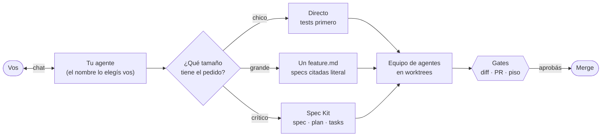
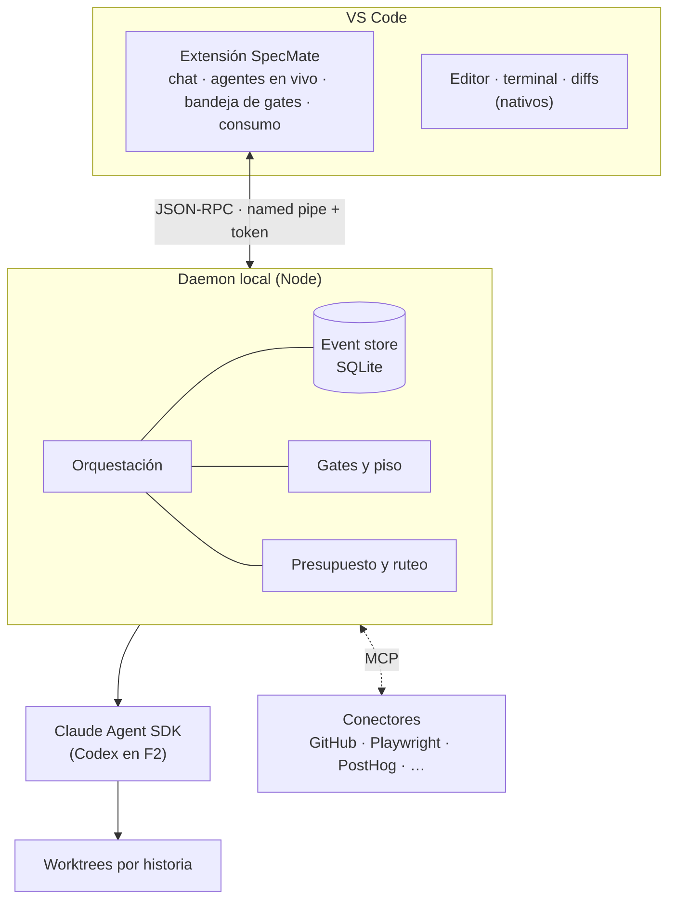

<div align="center">

# SpecMate

**Tu compañero de desarrollo con IA.**
Le hablás a un solo agente y él lleva cada ticket hasta el merge con un equipo de
agentes, specs, gates de aprobación y el costo bajo control.
Local, en VS Code, con tu propia suscripción.


[Por qué](#por-qué-specmate) · [Cómo funciona](#cómo-funciona) ·
[Arquitectura](#arquitectura) · [Roadmap](#roadmap) · [Contribuir](#trabajar-en-el-repo) ·
[Documentación](#documentación)

</div>

> [!IMPORTANT]
> **En construcción.** Estamos en el spike de la fase 0 ([E0](https://github.com/amiretti/SpecMate/issues/1)).
> Todavía no hay nada para instalar: este repo hoy contiene las decisiones, el kit de
> agentes con el que se construye el producto y el esqueleto del código.

---

## Por qué SpecMate

Programar con agentes de IA ya funciona. Lo que no funciona es **todo lo que pasa
alrededor**:

| El problema hoy | Lo que hace SpecMate |
|---|---|
| Hacés de director de orquesta: abrís sesiones, copiás contexto, repetís el pedido a cada agente | **Un solo interlocutor.** Le hablás a tu agente; él arma el equipo y te trae decisiones listas para aprobar |
| O todo es una charla suelta, o todo pasa por cinco documentos de spec | **Proceso proporcional al riesgo:** lo chico directo, lo grande con un documento, lo crítico con SDD completo |
| El agente pushea, borra o toca secretos cuando no debía | **Gates con piso:** push, PR, secretos y comandos destructivos siempre pasan por vos, en cualquier nivel de autonomía |
| La cuota se corta a mitad de una historia y perdés el hilo | **El costo es un requisito:** modelo justo por tarea, estimación antes de arrancar, consumo a la vista y checkpoint antes del corte |
| Cada herramienta te ata a un proveedor y a una nube | **Local y neutral:** corre en tu PC, usa tu suscripción, y los agentes viven en un formato propio que se proyecta a cada proveedor |

## Cómo funciona



1. **Le pedís algo a tu agente.** Un ticket de GitHub, una idea o un bug. En el primer
   arranque se presenta y te pregunta cómo querés llamarlo.
2. **Clasifica el pedido** con la *prueba de retomar*: ¿se podría seguir mañana solo con
   el pedido y el `git diff`? Y te dice la ruta en una línea, con su motivo
   ([ADR-0027](docs/adr/ADR-0027-flujo-proporcional.md)).

   | Ruta | Cuándo | Qué se escribe |
   |---|---|---|
   | **Chica** | Se entiende y el riesgo está acotado | Nada: el pedido va literal al agente |
   | **Grande** | Varias sesiones o esperas externas | Un solo `feature.md` con specs, tareas y registro |
   | **SDD** | Reglas de negocio, cliente que aprueba, zona crítica, arquitectura | [Spec Kit](https://github.com/github/spec-kit) completo |

3. **Arma el equipo y reparte el trabajo** entre analista funcional, product owner,
   arquitecto, backend, frontend, QA y seguridad. Cada uno con el modelo justo para su
   tarea, en su propio worktree, y con tests primero.
4. **Te frena solo donde importa.** Vos elegís cuánto intervenir:

   | Nivel | Aprobás |
   |---|---|
   | 0 · Paso a paso | Cada acción |
   | 1 · Supervisado *(default)* | Spec · plan · cada diff · PR |
   | 2 · Por hitos | Spec · plan · PR |
   | 3 · Plan y PR | Plan · PR |
   | 4 · Autónomo | Solo el PR |

   **El piso no se negocia:** el PR, el push, los secretos y los comandos destructivos
   pasan por vos incluso en Autónomo.
5. **Cierra la historia de verdad:** tablero, épica, ticket y memoria del proyecto
   actualizados, y lo que quedó destrabado.

## Arquitectura

Un **daemon local** concentra el estado y las reglas; **VS Code** pone el editor, la
terminal y los diffs; la **extensión** pone lo que es nuestro
([ADR-025 y ADR-026](docs/architecture/v2.md)).



| Nivel | Quién | Qué hace |
|---|---|---|
| 0 | **Daemon** | Lo determinista: estado, gates, presupuesto, checkpoints. Cero tokens |
| 1 | **Tu agente** (rol `chief`) | Habla con vos, prioriza, decide qué corre y reporta |
| 2 | **Team leaders** | Llevan cada historia: clasifican, reparten, verifican |
| 3 | **Agentes** | Analizan, especifican, implementan, prueban y revisan |

Nada escucha en la red: la extensión y el daemon se hablan por una named pipe con un
token por usuario.

## Stack

| | |
|---|---|
| **Runtime y lenguaje** | Node.js 24 LTS · TypeScript 7 estricto, ESM |
| **Build y calidad** | npm workspaces · esbuild · Biome · Vitest · `@vscode/test-cli` |
| **Comunicación y datos** | JSON-RPC (`vscode-jsonrpc`) · SDK de MCP · Zod 4 · `node:sqlite` |
| **Agentes** | Claude Agent SDK · Codex app-server desde F2 |
| **Interfaz** | Extensión de VS Code · Preact + `@vscode-elements/elements` |
| **Proceso** | Spec Kit con preset propio · Engram como memoria del proyecto |
| **CI** | GitHub Actions en Windows y Ubuntu |

El porqué de cada elección y lo que se descartó:
[ADR-0028](docs/adr/ADR-0028-stack-tecnologico.md). Windows es la plataforma principal.

## Roadmap

| Fase | Qué trae | Épicas |
|---|---|---|
| **F0 · Spike** ← *acá estamos* | Validar suscripción, concurrencia y daemon + extensión en Windows | [E0](https://github.com/amiretti/SpecMate/issues/1) |
| **F1 · MVP** | Un agente, un equipo, del ticket al PR con gates y costo bajo control | E1 a E7 |
| **F2** | Codex y varias suscripciones con ruteo | E8 |
| **F3** | Equipos en paralelo, cada uno con su team leader | E9 |
| **F4** | Tu agente en el celular: Telegram, audios y aprobaciones con segundo factor | E10 |
| **F5** | Equipo humano y biblioteca compartida de agentes | E11 |
| **Después** | Producto para terceros | E12 |

**El MVP se mide en uso real:** 5 historias de Harvi llevadas de ticket a merge en al
menos 2 proyectos, cero rehechas después del merge y costo real dentro de ±50 % de lo
estimado. Detalle en [docs/mvp.md](docs/mvp.md) y en las
[épicas](https://github.com/amiretti/SpecMate/issues?q=label%3A%C3%A9pica).

## Principios

La [constitución](.specify/memory/constitution.md) manda sobre todo lo demás. En corto:

- **Simplicidad primero.** Lo mínimo que resuelve el problema de hoy.
- **Verificable o no está hecho.** El test va primero y el rojo se observa.
- **Local primero, neutral al proveedor.**
- **El costo es un requisito**, no una optimización.
- **Proceso proporcional al riesgo.**
- **Seguridad en dos capas** y **fallar ruidosamente.**

Orden de autoridad: **ADR > spec > criterio propio.**

## Estructura del repo

```
packages/
  daemon/       núcleo local: orquestación, event store, gates, presupuesto
  extension/    extensión de VS Code: chat, agentes, bandeja de gates, consumo
.agents/        roles, skills, conectores MCP y ruteo (fuente neutral al proveedor)
.specify/       Spec Kit: constitución, plantillas, preset workspace-sdd
specs/          una carpeta por historia (feature.md o artefactos de Spec Kit)
docs/           MVP, arquitectura, kit y ADR
tools/          proyector a cada proveedor, configuración de usuario, conectores
```

## Trabajar en el repo

SpecMate se construye con su propio kit de agentes, hoy sobre Claude Code.

**Requisitos:** Node.js 24 (`nvm use` toma el `.nvmrc`), Git y
[Claude Code](https://docs.claude.com/en/docs/claude-code/overview) con tu suscripción.

```bash
npm install
node tools/project.mjs claude   # genera la configuración de Claude Code desde .agents/
claude                          # abre tu agente; la primera vez te pide su nombre
```

| Comando | Qué hace |
|---|---|
| `npm run build` | Compila los dos paquetes |
| `npm test` | Corre los tests |
| `npm run lint` | Lint y formato |
| `node tools/project.mjs claude --check` | Avisa si la configuración generada quedó vieja |
| `node tools/mcp.mjs grant <conector> <rol> --story <id>` | Habilita un conector a un rol para una historia |

> [!NOTE]
> `CLAUDE.md`, `.claude/` y `.mcp.json` **son generados**: se editan los fuentes en
> `.agents/` y se vuelve a proyectar. Las reglas para agentes están en
> [AGENTS.md](AGENTS.md).

**Convenciones:** ramas `###-slug`, commits `<type>: <desc>`, PR con `Closes #n`.
Spec Kit ya está inicializado; en una PC nueva sus skills se regeneran con
`specify init --here --force --integration claude --script ps --preset ./.agents/speckit-preset`.

## Documentación

| Documento | Qué tiene |
|---|---|
| [docs/mvp.md](docs/mvp.md) | Brief del MVP, métricas, spike y orden de las épicas |
| [docs/architecture/v2.md](docs/architecture/v2.md) | Arquitectura vigente y ADR-001 a ADR-026 |
| [docs/kit.md](docs/kit.md) | Cómo funciona el kit de agentes |
| [docs/adr/](docs/adr/) | Decisiones de arquitectura |
| [Constitución](.specify/memory/constitution.md) | Principios, stack y barandas |
| [AGENTS.md](AGENTS.md) | Instrucciones para cualquier agente que trabaje en el repo |

## Licencia

Sin licencia por ahora: **todos los derechos reservados**. El código es visible, pero no
se puede usar, copiar ni redistribuir sin permiso.

<div align="center">
<sub>Hecho en Santa Fe, Argentina, por <a href="https://github.com/amiretti">Andy Miretti</a> y el equipo de Harvi.</sub>
</div>
