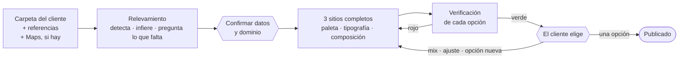

<div align="center">

# SpecMate

**De la carpeta del cliente a la web publicada.**
Le das el material del negocio y un par de referencias (más su ficha de Google Maps, si
la tiene), y
SpecMate entrega un sitio estático listo para publicar: datos confirmados, diseño
propio, tests y controles de seguridad que no dejan salir nada en rojo.


-BC52EE)


[Por qué](#por-qué-specmate) · [Cómo funciona](#cómo-funciona) ·
[Qué controla](#qué-controla-antes-de-publicar) · [Roadmap](#roadmap) ·
[Contribuir](#trabajar-en-el-repo) · [Documentación](#documentación)

</div>

> [!IMPORTANT]
> **En construcción.** Estamos en el spike de la fase 0 ([E0](https://github.com/amiretti/SpecMate/issues/1)).
> Todavía no hay nada para instalar. Hoy este repo tiene las decisiones, el kit de
> agentes y el esqueleto del código.

---

## Por qué SpecMate

Un negocio local necesita un sitio que diga la verdad, cargue rápido, aparezca en
Google y no se pueda romper. Los generadores con IA lo resuelven rápido desde una
descripción, pero inventan, dejan el sitio atado a su plataforma y nadie verifica qué
publican.

| El problema | Lo que hace SpecMate |
|---|---|
| El generador inventa horarios, servicios o testimonios | **Nada se publica sin fuente:** cada dato sale del material del cliente y el cliente lo confirma antes de construir |
| Todos los sitios hechos con IA se parecen | **Tres sitios reales para elegir, y mezclables:** el cliente ve su sitio terminado, no un boceto, y puede combinar partes de las tres opciones |
| "Es seguro" sin nada que lo respalde | **Controles que bloquean:** CSP estricta, nada inline, dependencias auditadas, secretos escaneados. Si algo da rojo, no se publica |
| Lento en el celular, invisible en Google | **HTML estático:** rendimiento ≥ 90 en Lighthouse, SEO local con `LocalBusiness` y sin JavaScript de más |
| El sitio queda en una plataforma ajena | **El código es del cliente:** un repo por sitio, hosting en Cloudflare, sin costo mensual de plataforma |

## Cómo funciona



1. **Relevamiento.** Abrís la carpeta del cliente en VS Code y SpecMate **busca antes de
   preguntar**: manual de marca, logo, fotos, textos y precios. Infiere el rubro, el
   objetivo del sitio y el tono, y solo pregunta lo que falta. Si el negocio está en Google
   Maps, Maps pre-llena y cruza datos, pero lo que se publica es lo que confirma el cliente, porque sus
   términos no permiten copiar su contenido.
2. **Confirmar datos y dominio.** Cada dato aparece con su fuente; nada sigue hasta
   confirmarlo. Es la primera de las dos intervenciones humanas.
3. **Tres sitios completos.** El sistema elige paleta, tipografía y composición (del
   manual de marca si existe; si no, del logo, el rubro y el tono) y arma tres sitios
   reales, distintos a propósito, con secciones de una biblioteca ya verificada.
4. **Verificación.** Cada opción pasa todos los controles de abajo antes de que el
   cliente la vea.
5. **El cliente elige**, mirando sus tres sitios en URLs de prueba. Puede pedir un mix
   ("la portada de la 2 con los colores de la 3"), un ajuste o una opción nueva: cada
   pedido es una versión nueva, y el mix sale en minutos porque recombina partes.
6. **Se publica** exactamente la versión elegida, en Cloudflare.

## Qué controla antes de publicar

| Control | Umbral |
|---|---|
| Datos del negocio | 100 % con fuente y confirmación; 0 texto de relleno |
| Inyección de código | 0 `<script>`, `<style>` o `on*=` inline; `set:html` prohibido |
| Headers | CSP sin `unsafe-inline` ni `unsafe-eval`, HSTS, `nosniff`, `Referrer-Policy`, `Permissions-Policy` |
| Dependencias y secretos | `npm audit` sin altas ni críticas; secretlint sin hallazgos |
| Orígenes externos | Solo los de la lista blanca del brief |
| Comportamiento | Playwright en 360, 768 y 1280 px, sin errores de consola |
| Accesibilidad | axe-core sin violaciones serias ni críticas |
| Lighthouse móvil | Rendimiento ≥ 90; accesibilidad, buenas prácticas y SEO ≥ 95 |
| HTML, enlaces e imágenes | Sin errores; sin enlaces internos rotos; imágenes ≤ 250 KB y con `alt` |

El detalle y el porqué de cada control: [ADR-0030](docs/adr/ADR-0030-stack-y-barandas-de-los-sitios.md).

## Stack

| | |
|---|---|
| **Sitios** | Astro 7 estático · CSS con los tokens del cliente · fuentes autoalojadas · Cloudflare |
| **Verificación** | Playwright · axe-core · Lighthouse CI · html-validate · linkinator · secretlint |
| **Herramienta** | Node.js 24 · TypeScript 7 · npm workspaces · esbuild · Biome · Vitest · Zod |
| **Agentes** | Claude Code con la capa `.agents/`, neutral al proveedor |

## Roadmap

| Fase | Qué trae | Épicas |
|---|---|---|
| **F0 · Spike** ← *acá estamos* | Un sitio real hecho a mano con el flujo, horas medidas, Places y CSP probados | [E0](https://github.com/amiretti/SpecMate/issues/1) |
| **F1 · MVP** | Plantilla segura, relevamiento guiado, opciones combinables, biblioteca de secciones, verificación y publicación | E1 a E5 |
| **F2 · Uso real** | Tres clientes de Harvi publicados y medidos | E6 |
| **Después** | Formulario con backend · mantenimiento y re-auditoría · edición por el cliente · producto para otras agencias · relevamiento hecho por el cliente | E7 a E11 |

**El MVP se mide en sitios reales:** 3 publicados, ≤ 3 horas de trabajo de Harvi por
sitio (hoy unas 24), dos intervenciones humanas, 0 datos sin confirmar y Lighthouse en
verde. Detalle en [docs/mvp.md](docs/mvp.md).

## Principios

La [constitución](.specify/memory/constitution.md) manda sobre todo lo demás. En corto:

- **Nada se publica sin fuente.**
- **Agnóstico al cliente:** nada de un cliente vive en este repo.
- **Verificable o no está hecho.** El test va primero y el rojo se observa.
- **Lo publicado no ejecuta nada ajeno.**
- **Simplicidad primero:** HTML estático, sin backend ni CMS hasta que un cliente lo
  necesite.
- **Lo que se resuelve sin modelo, se resuelve sin modelo.**

Orden de autoridad: **ADR > spec > criterio propio.**

## Estructura del repo

```
packages/
  cli/          specmate new · brief · verify · publish
templates/
  site/         plantilla de cada sitio de cliente (Astro, CSP, tests)
.agents/        roles, skills y conectores (fuente neutral al proveedor)
.specify/       Spec Kit: constitución, plantillas y preset
specs/          una carpeta por historia
docs/           MVP, ADR y kit
tools/          proyector a cada proveedor y conectores
```

## Trabajar en el repo

SpecMate se construye con su propio kit de agentes, hoy sobre Claude Code.

**Requisitos:** Node.js 24 (`nvm use` toma el `.nvmrc`), Git y
[Claude Code](https://docs.claude.com/en/docs/claude-code/overview).

```bash
npm install
node tools/project.mjs claude   # genera la configuración de Claude Code desde .agents/
claude                          # abre el lead, el agente principal
```

El kit es chico a propósito: el **lead** trabaja inline y delega solo cuando puede
nombrar el motivo.

| Rol | Qué hace |
|---|---|
| `lead` | Clasifica cada pedido (chico, grande o SDD), trabaja, verifica y es el único que toca git |
| `developer` | El CLI y las herramientas, en TypeScript |
| `frontend` | La plantilla del sitio y la biblioteca de secciones, en Astro |
| `qa` | Verificador independiente: suite completa y controles de `verify` |
| `security` | Revisión de los sitios publicados y de la herramienta |

Detalle en [docs/kit.md](docs/kit.md).

| Comando | Qué hace |
|---|---|
| `npm run build` | Compila los paquetes |
| `npm test` | Corre los tests |
| `npm run lint` | Lint y formato |
| `node tools/project.mjs claude --check` | Avisa si la configuración generada quedó vieja |

> [!NOTE]
> `CLAUDE.md`, `.claude/` y `.mcp.json` **son generados**: se editan los fuentes en
> `.agents/` y se vuelve a proyectar. Las reglas para agentes están en
> [AGENTS.md](AGENTS.md).

**Convenciones:** ramas `###-slug`, commits `<type>: <desc>`, PR con `Closes #n`.

## Documentación

| Documento | Qué tiene |
|---|---|
| [docs/mvp.md](docs/mvp.md) | Brief del MVP, flujo, métricas, spike y épicas |
| [docs/adr/](docs/adr/) | Decisiones de arquitectura. Las del producto actual: [0029](docs/adr/ADR-0029-pivot-sitios-para-negocios.md) (pivot), [0030](docs/adr/ADR-0030-stack-y-barandas-de-los-sitios.md) (stack y controles), [0031](docs/adr/ADR-0031-relevamiento-guiado.md) (relevamiento) y [0032](docs/adr/ADR-0032-opciones-combinables.md) (opciones combinables) |
| [Constitución](.specify/memory/constitution.md) | Principios, stack y barandas |
| [docs/kit.md](docs/kit.md) | El kit de agentes con el que se construye SpecMate |
| [AGENTS.md](AGENTS.md) | Instrucciones para cualquier agente que trabaje en el repo |

## Licencia

Sin licencia por ahora: **todos los derechos reservados**. El código es visible, pero no
se puede usar, copiar ni redistribuir sin permiso.

<div align="center">
<sub>Hecho en Santa Fe, Argentina, por <a href="https://github.com/amiretti">Andy Miretti</a> y el equipo de Harvi.</sub>
</div>
