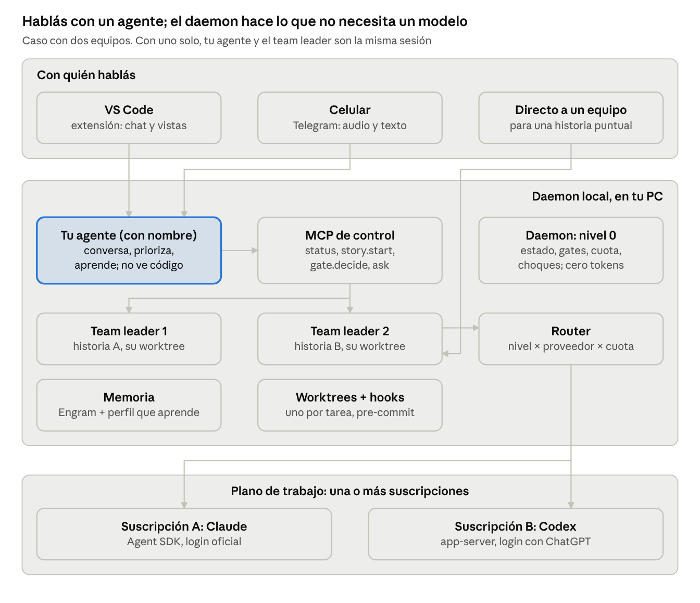
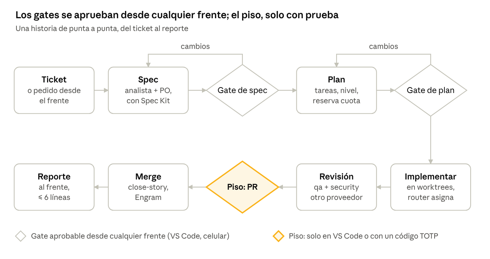
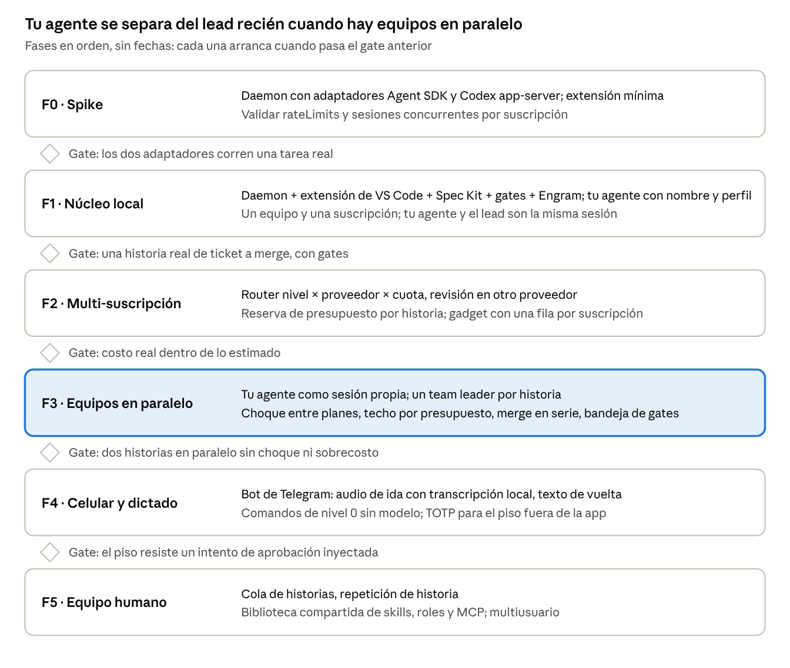

# Arquitectura v2 — Workspace de agentes con SDD

Oct 27, 2026 · @Andy

## Resumen

SpecMate: un workspace local (daemon + extensión de VS Code) donde **le hablás a un solo agente propio, con el nombre que le pongas**, y él lleva tickets hasta el merge con uno o más equipos de agentes, usando las suscripciones de IA que ya pagás, con la disciplina de Spec Kit y con el costo bajo control.

*Revisión del 27/10: Dots queda descartado; lo reemplaza un agente superior propio.*

**Qué cambia respecto de la v1** (14 al 19/10, 18 ADR, documento *Arquitectura v1*):

1. **Un interlocutor propio.** Le hablás a tu agente, con el nombre que le pongas en el primer arranque: conversa, prioriza, decide qué corre en paralelo y aprende tus preferencias. No ve código.
2. **Varios equipos en paralelo.** Un team leader por historia, cada uno en su sesión y su worktree. Con un solo equipo, tu agente y el team leader son la misma sesión.
3. **Núcleo en un daemon local, interfaz en VS Code.** Terminal, editor y diffs los pone VS Code; nosotros ponemos el gobierno. Sin fork y sin app de Electron.
4. **Lo determinista no gasta tokens.** Estado, gates, cuota, alertas y choques entre historias los resuelve el daemon (nivel 0), sin modelo.
5. **Varias suscripciones a la vez.** El router reparte cada tarea por nivel, proveedor y **presupuesto disponible** de cada suscripción.
6. **Celular por Telegram:** audio de ida, texto de vuelta, cero tokens extra.
7. **Consolidación.** Lo decidido en la v1 se mantiene (Spec Kit con preset propio, Engram, capa neutral `.agents/`, autonomía 0 a 4, checkpoint), salvo el shell Electron y el visor propio.

**Las decisiones que importan:**

| # | Decisión | Por qué |
| --- | --- | --- |
| 1 | Hablás con un agente propio; Dots queda afuera | Dots no tiene API, no figura en Argentina, cuesta USD 100 o más por mes y no puede orquestar (§3) |
| 2 | Daemon local + extensión de VS Code; sin fork | Terminal y editor sin construirlos ni mantener un fork; corre donde el developer ya trabaja |
| 3 | Lo que no necesita un modelo lo hace el daemon | Cada consulta de estado que responde un modelo es una vuelta pagada |
| 4 | El nivel superior existe solo con dos o más equipos en paralelo | Cada salto entre agentes vuelve a pagar el mensaje y su contexto |
| 5 | Router por nivel × proveedor × presupuesto | Usar dos suscripciones como un solo pool es la palanca de costo más grande que queda |
| 6 | Lo que se resuelve una vez se resuelve al proyectar | Cada paso en runtime es una vuelta del modelo y una dependencia más |
| 7 | Celular por bot de Telegram, sin backend propio | Conexión saliente, audio transcripto en la PC, cero tokens extra |

## Mercado: quién hace qué a octubre de 2026

El paralelismo con worktrees ya es commodity. Lo que nadie junta en un solo producto local es: **frente conversacional único + SDD con gates + autonomía graduada + costo como restricción de diseño + varias suscripciones a la vez**.

| Producto | Qué resuelve bien | Qué no resuelve (para nuestro caso) | Qué tomamos |
| --- | --- | --- | --- |
| **GitHub Agent HQ** (feb. 2026) | *Mission control* para Copilot, Claude y Codex sobre el repo; asignar issues a agentes | Atado a GitHub y a Copilot Pro+/Enterprise; nube; sin SDD ni control de costo por tarea | Asignar un ticket como unidad de trabajo; comparar agentes en la misma tarea |
| **Cursor 3** | Agents Window, agentes en paralelo con worktree propio, *handoff* local↔nube, `/multitask`, plugins | IDE completo (no es lo que queremos), suscripción propia, gobierno liviano | Vista de agentes en paralelo; handoff local↔nube como idea futura |
| **Claude Code** (CLI, desktop, nube) | Subagentes, worktrees, Routines, Projects (beta) que coordinan sesiones, Remote Control desde el celular, marketplace de plugins con hash fijado | Un solo proveedor; *agent teams* sigue en preview; sin SDD propio | Agent SDK como adaptador; plugins con hash fijado para la biblioteca |
| **Codex** (app, CLI, nube, app-server, móvil) | Login con ChatGPT por app-server oficial, tareas en nube o locales, cuenta de límites legible | Un solo proveedor; orquestación multi-rol propia, no la nuestra | Adaptador app-server; `account/rateLimits/read` para el gadget |
| **Dots** (OpenAI, sep. 2026) | Agente siempre encendido, coordinador, canales (ChatGPT, Slack, Teams, voz) | Sin API, solo planes Pro/Business Premium, no figura en Argentina, no orquesta | Evaluado y **descartado** como interlocutor (§3). Queda la idea del MCP de control |
| **Devin** (+ Windsurf) | Agente autónomo en nube, tickets a PR | Caro, nube, cerrado | Nada nuevo |
| **opencode, Cline, Kilo Code, Zed, Amp, Gemini CLI** | Agentes BYO-key, multi-proveedor, abiertos | Un agente, no un equipo; sin gates ni SDD | Confirmación de que multi-proveedor es expectativa base |
| **Conductor** | Agentes Claude/Codex en paralelo, simple | Solo Mac | UX de lista de agentes |
| **Kiro** (AWS) | IDE spec-driven (requisitos → diseño → tareas) | IDE propio, atado a AWS | Valida la apuesta por SDD |
| **Spec Kit / BMAD** | Método SDD abierto | Son método, no producto | Spec Kit es nuestro motor; de BMAD, seis ideas (v1) |

**Posicionamiento v2:** *el centro de control local del developer que ya paga una o dos suscripciones de IA*. No compite con el IDE ni con el agente: los dirige con proceso y con presupuesto.

**Riesgo de mercado honesto:** GitHub Agent HQ y Claude Code Projects van hacia el mismo lugar desde arriba. Nuestra defensa no es el paralelismo ni la UI; es la neutralidad de proveedor, el proceso (Spec Kit + gates) y el control de costo. Si alguno de ellos suma las tres, el producto se reduce a una opinión de proceso empaquetada.

## Tu agente: un solo interlocutor propio

### Por qué no Dots

Se evaluó Dots (OpenAI, sep. 2026) como interlocutor y **se descarta**:

| Motivo | Detalle |
| --- | --- |
| No orquesta | No ve disco, git ni worktrees; solo usa modelos de OpenAI; no mide consumo; no deja un registro claro de actividad |
| Sin API | Solo se integra como cliente de un conector MCP propio, con Developer mode y un relay en la nube |
| Disponibilidad | Argentina no figura en los listados de países encontrados |
| Costo | Solo en ChatGPT Pro (desde USD 100/mes) o Business Premium, únicamente para conversar |
| Aprobaciones | Un pedido explícito en el chat cuenta como aprobación: no sirve para el piso |
| Fuga silenciosa de cuota | Si crea tareas de Codex por su cuenta, gastan cuota de Codex y el workspace no las ve |

Lo único valioso de la evaluación queda: **el MCP de control**. Lo usa nuestro propio agente.

### Qué es tu agente

Un rol nuevo, `chief`. Conversa con vos, prioriza el backlog, decide qué historias corren en paralelo, levanta y sigue a los team leaders y te reporta. **No lee código ni diffs, nunca**: su contexto es tu perfil, un resumen del portfolio y las decisiones abiertas. Por eso alcanza el nivel `estándar`, y `rápido` para consultas de estado que la app no pueda responder sola.

**El nombre lo elige cada usuario en el primer arranque; el framework no trae ninguno de fábrica.** Al desplegarse, el agente se presenta de forma amable, cuenta en pocas líneas qué va a hacer por vos y te pregunta cómo querés llamarlo (skill `onboarding`). El nombre se guarda en la configuración de usuario (`~/.workspace/user.json` → `"agentName"`), no en el repo: cada miembro de un equipo le habla a *su* agente con *su* nombre, y vale para todos sus proyectos. Se puede cambiar en cualquier momento pidiéndoselo al agente. El proyector inyecta el nombre en las instrucciones del agente y en los mensajes del bot.

Como default del producto no se usa un nombre de un personaje con marca registrada: es elección de cada usuario, no algo que el framework distribuya.

### Cuatro niveles, y el primero no gasta tokens

| Nivel | Quién | Qué hace | Costo |
| --- | --- | --- | --- |
| 0 | App | Estado, gates pendientes, consumo, alertas, choques entre historias | Cero tokens |
| 1 | Tu agente (`chief`) | Conversa, prioriza, decide el paralelismo, aprende | Bajo: contexto chico, sin código |
| 2 | Team leaders (uno por historia) | El `lead` de la v1: spec, plan, tareas, gates | Como en la v1 |
| 3 | Agentes | Implementan y revisan | Como en la v1 |

**Con un solo equipo, los niveles 1 y 2 son la misma sesión.** El `chief` aparece como sesión aparte solo cuando hay dos o más historias en paralelo. Mientras tanto no existe y no cuesta.

### El teléfono descompuesto se paga

Cada salto (vos → chief → team leader → agente) vuelve a leer el mensaje con su contexto. Reglas para que no se multiplique:

- **Preguntá al nivel que sabe.** Para discutir a fondo una historia (un diseño, un bug), te conectás **directo** a su team leader. Pasarlo por el chief duplicaría el costo. El chief queda para lo que cruza historias: qué va primero, qué corre en paralelo, cómo viene el presupuesto.
- **El chief no retransmite: deriva.** Si le preguntás algo de una historia, te abre la conversación con su team leader en lugar de preguntarle por vos.
- **Lo que la app sabe, lo responde la app.** "¿Cómo va la US-12?" sale del event store, sin modelo.

### Equipos en paralelo

- **Cada team leader es una sesión propia** que levanta el daemon, en su worktree y con la suscripción que asigna el router. **No es un subagente del chief**, aunque Claude Code ya permite anidar subagentes (hasta tres niveles por defecto, según su documentación): como sesión propia, cada equipo puede correr en otro proveedor que el chief, tiene su propio contexto y presupuesto, y sobrevive a que se cierre la conversación del chief. El chief los maneja con el **MCP de control**.
- **Choques, antes de arrancar.** El daemon compara las rutas que declara cada `plan.md`. Si dos historias tocan los mismos archivos, el mismo contrato o el mismo build, van en serie. Es una comparación determinista, no un juicio del modelo.
- **Techo por presupuesto.** Cuántos equipos corren a la vez lo decide la cuota disponible y la reserva de cada historia (§9). Dos equipos consumen el doble de rápido.
- **Un solo merge a la vez** a la rama base, con rebase y suite del segundo sobre el primero.

### Que aprenda de vos

- **Perfil de usuario** en un archivo chico, a nivel usuario (no de proyecto): preferencias, vocabulario, cómo querés los reportes, decisiones que repetís. **Tope de tamaño fijo.** Se carga siempre como prefijo estable, así que el caché de prompt lo abarata.
- **Se actualiza solo al cerrar sesión o historia, sin pedir OK** (decidido el 27/10). Nunca en cada turno. Cada actualización queda en un historial con su diff, y podés ver, editar o revertir el perfil cuando quieras.
- Lo que no entra en el tope vive en Engram y se busca cuando hace falta. Los pitfalls se siguen promoviendo a `AGENTS.md` como en la v1.

### Nombre, sí; personaje, no

El nombre o apodo cuesta unos pocos tokens en las instrucciones. Una personalidad elaborada se pagaría en cada respuesta: el tono sigue siendo `terse`.

### Audio

| Modo | Decisión | Por qué |
| --- | --- | --- |
| Dictado con transcripción local | **Sí, más adelante** | No cuesta tokens: al modelo le llega texto. Pulsar para hablar y ver el texto antes de enviar, porque hablando somos más verborrágicos. Rendimiento en una PC sin GPU a verificar |
| Respuestas en voz | No | Los reportes son tablas y listas cortas; para que suenen bien habría que escribir prosa más larga |
| APIs de voz en tiempo real | No | Caras y aparte de las suscripciones |

## Varias suscripciones a la vez

Tu agente (`chief`) y los equipos pueden correr en la misma suscripción o en suscripciones distintas, del mismo proveedor o de otro.

### Combinaciones

| # | Tu agente | Equipos | Para quién | Comentario |
| --- | --- | --- | --- | --- |
| A | Claude | Claude | Quien paga solo Claude Pro/Max | **Default.** Un proveedor, todo local |
| B | Codex | Codex | Quien paga solo ChatGPT | Igual que A con OpenAI |
| C | Claude | Claude + Codex | Quien paga los dos | **La más potente:** dos pools de cuota, router por presupuesto, revisión cruzada |
| D | Codex | Claude | Quien quiere separar conversar de trabajar | Lo que planteaste con Dots, sin Dots: la charla no compite por la cuota de los equipos |
| E | Cualquiera | API keys | Equipos o CI | Pago por uso; el presupuesto pasa a ser en dólares |

Con una sola suscripción, el chief consume poco por diseño (sin código, contexto chico, la app responde el estado), así que separarlo es una opción y no una necesidad.

### El router: nivel × proveedor × presupuesto

En la v1 el lead elegía el **nivel** (rápido, estándar, máximo). En la v2 elige también **en qué suscripción** corre, con tres reglas en orden:

1. **Afinidad:** si un rol tiene proveedor fijado en `.agents/roles/<rol>.md` (`runtime: claude`), va ahí.
2. **Presupuesto:** gana la suscripción con más margen en su ventana de 5 h y semanal. Por encima del 85 % de una ventana, esa suscripción deja de recibir tareas nuevas de nivel estándar o máximo.
3. **Diversidad en la revisión:** cuando hay dos proveedores, `qa` y `security` corren en **el otro**. Un modelo distinto revisando ataca la debilidad que señalamos en BMAD (revisores del mismo modelo).

Si no hay margen en ninguna: checkpoint (v1) y aviso al frente.

### Configuración: `runtimes.json` v2

### El gadget de consumo con varias suscripciones

```json
{
  "subscriptions": {
    "claude-max": { "runtime": "claude", "auth": "subscription",
      "tiers": { "rapido": "haiku", "estandar": "sonnet", "maximo": "opus" } },
    "chatgpt-pro": { "runtime": "codex", "auth": "subscription",
      "tiers": { "rapido": "<completar>", "estandar": "<completar>", "maximo": "<completar>" } }
  },
  "routing": {
    "chief": "claude-max",
    "teams": ["claude-max", "chatgpt-pro"],
    "review": "other",
    "stopAt": 0.85,
    "maxParallelTeams": "auto"
  }
}
```

`routing.chief` fija dónde corre tu agente; `teams`, entre qué suscripciones reparte el router. `maxParallelTeams: auto` deja el techo de paralelismo al presupuesto (§3). Los modelos de OpenAI quedan para completar al configurar: no los fijo de memoria.

### El gadget de consumo con varias suscripciones

Una fila por suscripción, con sus dos ventanas (5 h y semanal), lo que reservaron las historias en curso y qué equipo usa cada una. Aparte, cuánto consume el chief, para ver cuánto cuesta conversar. Claude: `rate_limits` del statusLine (en SDK headless, solo `rate_limit_event`). Codex: `account/rateLimits/read`.

### Política de proveedores

Cada usuario usa **su propia** suscripción en su máquina, con el login oficial de cada runtime (Agent SDK y Codex app-server). El producto **no ofrece login de Claude.ai ni enruta credenciales de terceros**: eso Anthropic lo prohíbe. En modo equipo, cada miembro trae la suya o se usan API keys.

## Arquitectura v2



El diagrama muestra el caso con dos equipos. Con uno solo, tu agente y el team leader son la misma sesión. La app (nivel 0) responde todo lo que no necesita un modelo, y el chief nunca toca código: le habla a los equipos por el MCP de control.

## Interfaz: extensión de VS Code sobre un daemon local

*Decisión tomada el 27/10 (ADR-025 y ADR-026, aceptadas).*

### Qué se decidió

- **El núcleo corre en un daemon local en Node, sin ventana:** JARVIS, team leaders, router, gates, event store, Engram, worktrees, presupuesto, MCP de control y bot de Telegram.
- **La interfaz principal es una extensión de VS Code**, publicada en el Visual Studio Marketplace y en Open VSX. Funciona en VS Code y en sus derivados (Cursor, Windsurf, Kiro, VSCodium).
- **No se hace fork de VS Code, ni terminal ni editor propios.** La app de Electron sale del plan.

### Por qué

| Opción | Qué da | Costo | Veredicto |
| --- | --- | --- | --- |
| Fork de Code-OSS | Control total, como Cursor | Rebase de cada versión mensual para siempre; sin acceso al Marketplace de Microsoft; sin sus extensiones propietarias (C# Dev Kit, debugger de .NET, Pylance, Remote SSH; en 2025 Microsoft ya bloqueó la de C/C++ en forks); quitar marca, telemetría y servicios; builds firmados propios | **Descartada** |
| **Extensión de VS Code** | Terminal, editor, LSP, debugging, explorador y git sin construirlos; corre donde el developer ya trabaja | Bajo | **Elegida** |
| Eclipse Theia | Framework para IDEs propias, compatible con extensiones de VS Code, sin fork | Medio: es armar y mantener una IDE | Plan B si algún día hace falta una IDE propia |
| Electron propio + Monaco editable | Control de la UI | Alto: llegar a una experiencia de IDE es reconstruir VS Code a mano | Descartada |

El fork no ahorra un solo token: es puro costo de ingeniería, y compite con Microsoft en su propio terreno. La extensión recorta del roadmap la terminal y el editor, que no son nuestro diferencial.

### Qué pone VS Code y qué ponemos nosotros

| Necesidad | Quién la resuelve |
| --- | --- |
| Terminal del usuario | VS Code |
| Salida de los agentes en vivo | Terminal virtual de la extensión (`Pseudoterminal`), alimentada por el daemon |
| Editor enriquecido, LSP, debugging | VS Code y las extensiones del usuario, incluidas las de Microsoft que un fork no podría usar |
| Revisión de cambios en los gates | Editor de diffs nativo, abierto sobre el worktree de la historia |
| Explorador de archivos y git | VS Code; los worktrees los maneja el daemon |
| Chat con JARVIS, agentes en paralelo, bandeja de gates, gadget de consumo, specs | Vistas de la extensión (webviews y tree views) |

### Cómo se conectan

- **Solo local.** El daemon escucha en una named pipe (Windows) o un socket Unix, nunca en la red. Cada conexión presenta un token por usuario generado al instalar y guardado en el almacenamiento seguro del sistema.
- **Dos superficies:** el MCP de control (lo usa JARVIS y cualquier cliente MCP) y un stream de eventos del event store para las interfaces.
- **Arranque:** lo levanta la extensión si no está corriendo. Opcionalmente arranca con la sesión de Windows, para que el bot de Telegram responda aunque VS Code esté cerrado.
- **Un daemon por usuario**, varias ventanas de VS Code como clientes, una base por proyecto.

### Costo asumido

- La UI queda limitada a lo que permite la API de extensiones (webviews, tree views, paneles): no controlamos el layout.
- Dependemos de la API de extensiones de VS Code. Es la base de su propio ecosistema: riesgo bajo, pero real.
- Competimos dentro de la casa de Copilot. El diferencial (gobierno, costo, multi-proveedor) tiene que verse en la primera hora de uso.
- Quien use JetBrains, Zed o Neovim queda afuera por ahora. **Revisar cuando** haya demanda real: como el núcleo está separado, otra interfaz no toca el daemon.

## Flujo de una historia



El humano interviene en tres puntos. Los gates de spec y de plan se aprueban desde donde estés; el del piso (push y PR, entre otros) exige estar frente a la app o un código que ella muestra.

## Roles, skills y kit

Se mantiene el kit de la v1 (capa neutral `.agents/`, proyector, preset `workspace-sdd`). Cambios de la v2:

| Pieza | v1 | v2 |
| --- | --- | --- |
| `chief` (nuevo) | — | Tu interlocutor, con `displayName`. Prioriza, decide el paralelismo, deriva a los team leaders. Herramientas: solo el MCP de control y el perfil. Sin acceso a código |
| `lead` | Interlocutor y orquestador | Team leader de una historia. Con un solo equipo se fusiona con el `chief` en una sesión |
| Roles | `tier` + `capabilities` | Suman `runtime` opcional (afinidad de proveedor) y `review: other-provider` en `qa` y `security` |
| `model-routing` | Nivel por tarea | Nivel × suscripción × presupuesto (§4) |
| `runtimes.json` | Un runtime con niveles | Suscripciones + `routing` del chief y de los equipos (§4) |
| Skill nueva `chief-report` | — | Plantilla de los mensajes del chief: estado, gate pendiente, pregunta. ≤ 6 líneas, legible en el celular |
| Skill nueva `profile` | — | Al cerrar sesión o historia, propone el cambio al perfil del usuario respetando el tope. Queda visible y editable |
| `tasking` | Equipo mínimo y nivel | Agrega la suscripción por spawn, la reserva de presupuesto y las rutas que toca la historia (para detectar choques) |

**Lo que no cambia y por qué:** los nueve roles de la v1 alcanzan; el único nuevo es el `chief`. Evalué sumar un rol "router" o "dispatcher": lo descarto porque el ruteo es una función determinista de la app, no un juicio; ponerlo en un modelo es pagar tokens por un `if`.

## Autonomía y aprobaciones remotas

Los niveles 0–4 y el piso de la v1 siguen igual (default 1, Supervisado). Lo nuevo:

- **Una sola bandeja de gates** para todos los equipos (M4). El chief te los presenta ordenados por cuánto trabajo bloquea cada uno.
- **El chief no aprueba por vos.** Puede recomendar; la decisión es tuya en todos los niveles. En el nivel 4 rige lo que ya fijaba la v1, con el piso intacto.
- **Fuera de la app** (canal móvil, §15): los gates de spec y de plan se pueden aprobar; el piso, solo con un **segundo factor que un agente no pueda fabricar** (código de un uso o TOTP). Un "dale" escrito puede venir de una inyección (OWASP ASI01); un código de un autenticador, no.

Toda decisión de gate queda en el event store con su origen (`app`, `mcp:<cliente>`, `movil`).

### Canal móvil: Telegram, audio de ida y texto de vuelta (ADR-024)

Condición común a cualquier opción: **la PC tiene que estar prendida con la app abierta**. El trabajo corre ahí; el celular es una ventana.

| Opción | Veredicto | Por qué |
| --- | --- | --- |
| **Bot de Telegram** | **Canal principal** | Conexión saliente por *long polling* desde la app: sin relay, sin servidor propio, sin puertos abiertos. Audios nativos, API gratuita, neutral al proveedor de IA y sirve igual para cualquier usuario del producto |
| Remote Control de Claude | Complemento, si el spike lo confirma | Cero infraestructura, pero solo Claude, pensado para sesiones de Claude Code (falta saber si una sesión del Agent SDK lo activa) y muestra el chat del agente, no la bandeja de gates ni el consumo |
| Codex en la app de ChatGPT | No por ahora | Para la app de Codex en Windows figuraba "próximamente"; solo OpenAI |
| PWA propia + relay | Futuro, como producto | Mejor experiencia, pero exige un servidor |
| WhatsApp | Descartado | La API oficial exige alta de empresa en Meta y cobra por conversación; las librerías no oficiales violan sus términos |

**Cómo funciona:**

- **Audio de ida, cero tokens extra.** La nota de voz se descarga a la PC y se transcribe ahí; al agente le llega texto. Si la transcripción en una PC sin GPU es lenta, el plan B es el dictado del teclado del celular.
- **Texto de vuelta.** Mensajes de la skill `chief-report`: ≤ 6 líneas, para leer en el celular.
- **Comandos de nivel 0.** `/estado`, `/gates` y `/consumo` los responde la app desde el event store, sin modelo. El agente solo entra cuando hay que conversar o decidir.
- **Aprobaciones.** Spec y plan: botón en el chat. Piso: código TOTP de una app autenticadora (ADR-021). Un agente con una instrucción inyectada puede escribir "dale", pero no puede fabricar ese código.
- **Qué viaja.** Los chats con bots pasan por los servidores de Telegram sin cifrado de punta a punta. Por eso por el canal viajan resúmenes, estados e IDs, nunca código, diffs ni secretos, con el mismo filtro de secretos que el MCP de control.
- **Quién puede hablarle.** Lista blanca de IDs de chat de Telegram; cualquier otro remitente se ignora y queda registrado. El token del bot va al keychain del sistema operativo (ADR-003).

## Costo y consumo

El mandamiento de la v1 sigue: costo mínimo con calidad. Las palancas, ordenadas por impacto estimado:

| # | Palanca | Estado |
| --- | --- | --- |
| 1 | **No trabajar:** ruteo por tamaño (corta, normal, completa); el lead resuelve lo chico sin spawnear | v1 |
| 2 | Nivel de modelo por tarea (`model-routing`) | v1 |
| 3 | **Dos pools de cuota** como uno solo: el router reparte por margen (§4) | **v2** |
| 4 | Prompts de spawn masticados (extractos, ground-truth, no re-explorar) | v1 |
| 5 | Salida terse (≤ 15 líneas, sin volcar código) | v1 |
| 6 | Herramientas mínimas por agente (Engram solo lectura, \~420 tok/turno contra \~7.660) | v1 |
| 7 | Resolver al proyectar, no en runtime | v1 |
| 8 | **Reserva de presupuesto por historia:** la estimación del plan se descuenta antes de arrancar; si no hay margen, la historia no arranca | **v2** |
| 9 | **Frente barato:** las respuestas al frente salen de `story.report` (ya calculado), no de una vuelta nueva del lead | **v2** |
| 10 | Checkpoint al 85 % de sesión, 95 % semanal u 80 % de contexto | v1 |

**Métricas por historia** (event store): tokens y costo equivalente por rol, nivel y suscripción; estimado contra real; escaladas de nivel; vueltas de revisión; tiempo por etapa. Desvío > 2× es parte del piso.

## Memoria, contexto y seguridad

**Memoria (sin cambios):** Engram por proyecto (ADR-017), agentes en solo lectura, escrituras del lead por CLI al cerrar historia. Pitfalls que se repiten dos veces se promueven a `AGENTS.md`.

**Contexto hacia el frente (nuevo):** el MCP de control es una superficie de salida. Reglas:

- Devuelve resúmenes, estados e IDs. Nunca contenido de archivos, diffs ni variables de entorno.
- Pasa por el mismo filtro de secretos que los hooks de pre-commit antes de salir.
- Lista blanca de herramientas: el frente no puede invocar shell, git ni MCP de terceros a través del lead.

**Seguridad (dos capas de la v1 + el borde nuevo):**

| Riesgo | Control |
| --- | --- |
| Inyección desde tickets, docs o la web (LLM01, ASI01) | El texto externo es dato, nunca instrucción; gates del piso con código |
| Uso indebido de herramientas (ASI02) | Capabilities por rol proyectadas a herramientas concretas; el frente no hereda herramientas |
| Abuso de identidad y privilegios (ASI03) | Cada suscripción con su login oficial; el relay usa OAuth y token por dispositivo, revocable |
| Cadena de suministro (ASI04) | Skills externas detrás del piso; plugins con hash fijado |
| Fuga de datos sensibles (LLM02) | Filtro de secretos en la salida del MCP de control y en pre-commit |
| Comunicación entre agentes (ASI07) | Los agentes no se hablan entre sí: todo pasa por el lead y el event store |

## Mejoras de la v2: qué entra y qué no

Revisé la v1 contra el mercado buscando qué la haría "súper potente" sin romper el mandamiento de costo.

### Entran

| # | Mejora | Por qué vale | Costo |
| --- | --- | --- | --- |
| M1 | **Agente propio (`chief`) con nombre y perfil que aprende** (§3) | Un solo interlocutor que te conoce, sin depender de un producto ajeno | Bajo |
| M2 | **Router multi-suscripción** (§4) | Duplica la capacidad útil sin pagar más; revisión por un modelo distinto | Medio |
| M3 | **Cola de historias:** el chief toma la siguiente del tablero cuando se libera presupuesto, respetando gates | Trabaja mientras no estás, dentro de la cuota que ya pagaste | Bajo |
| M4 | **Bandeja de gates:** todo lo pendiente de decisión en un lugar | El humano es el cuello de botella; acá se ve cuánto espera cada gate | Bajo |
| M5 | **Reserva de presupuesto por historia** (§9) | Evita arrancar lo que no se puede terminar | Bajo |
| M6 | **Revisión cruzada de proveedor** en `qa` y `security` | Ataca el sesgo de un modelo revisándose a sí mismo | Cero si hay dos suscripciones |
| M7 | **Repetición de historia** desde el event store | Auditoría y aprendizaje | Bajo: el dato ya existe |
| M8 | **Team leaders en paralelo** con choque determinista y techo por presupuesto (§3) | Varias historias a la vez sin que se pisen ni revienten la cuota | Medio |

### Quedan afuera (y por qué)

| Idea | Por qué no |
| --- | --- |
| Dots como interlocutor u orquestador | No orquesta, sin API, no figura en Argentina, USD 100+ por mes (§3) |
| Fork de VS Code | Mantenimiento perpetuo, sin Marketplace ni extensiones propietarias de Microsoft (ADR-025) |
| Terminal y editor propios | Los pone VS Code (ADR-026) |
| Que el chief retransmita preguntas sobre una historia | Duplica el costo; deriva a su team leader |
| Respuestas en voz y voz en tiempo real | Más tokens o APIs aparte; los reportes son para leer (§3) |
| Personalidad elaborada para el agente | Se paga en cada respuesta; nombre sí, personaje no |
| Agentes que se hablan entre sí (estilo agent teams) | Más tokens y menos control; todo pasa por el lead y el event store. Revisar si agent teams sale de preview con ahorro medible |
| Ejecución en una nube propia | Rompe "local y liviano" y el uso de suscripciones personales |
| Debate multi-agente en cada decisión | Solo en RFC caros (skill `adr` §3.1) |

## Índice de ADR

De la v1 sin cambios salvo donde se indica. Nuevas: 019 a 024.

| ADR | Decisión | Estado v2 |
| --- | --- | --- |
| 001 | Shell Electron con React + TypeScript | **Reemplazada por ADR-025** |
| 002 | Runtimes delegados detrás de `AgentRuntime` (Agent SDK, Codex app-server) | Vigente; los corre el daemon |
| 003 | La app nunca manipula tokens de suscripción | Vigente; el token del bot y el del daemon también van al almacenamiento seguro |
| 004 | Workspace Event Bus con event store SQLite por proyecto | Vigente; en el daemon, con el origen de cada decisión de gate |
| 005 | MCP interno "workspace" para los agentes | Vigente; distinto del MCP de control (ADR-019) |
| 006 | Un worktree por tarea | Vigente |
| 007 | Artefactos SDD en Markdown en el repo | Vigente; precisado por ADR-016 |
| 008 | Visor de solo lectura | **Reemplazada por ADR-026** |
| 009 | Dots diferido a v2 vía MCP | **Reemplazada por ADR-019** (Dots descartado) |
| 010 | El ticket es la entrada del flujo | Vigente |
| 011 | Costo como restricción de primer nivel | Vigente; extendida por ADR-020 |
| 012 | Gadget de consumo con degradación honesta | Vigente; una fila por suscripción |
| 013 | Capa de configuración neutral `.agents/` | Vigente |
| 014 | Niveles de autonomía con piso | Vigente; precisada por ADR-021 |
| 015 | Checkpoint ante límite de consumo | Vigente |
| 016 | Spec Kit con preset `workspace-sdd` que compone | Vigente |
| 017 | Memoria con Engram detrás de `MemoryStore` | Vigente |
| 018 | Spec Kit instalado bajo demanda | Vigente |
| **019** | **Interlocutor propio (`chief`), cliente del MCP de control, sin acceso a código; se fusiona con el lead si hay un solo equipo.** Nombre por usuario. Dots descartado | Propuesta |
| **020** | **Router por nivel × suscripción × presupuesto**, con revisión en otro proveedor y reserva por historia | Propuesta |
| **021** | **El piso no se aprueba fuera de la app** sin un segundo factor que un agente no pueda fabricar (TOTP) | Propuesta |
| **022** | **Team leaders como sesiones independientes**, con choque determinista entre planes, techo por presupuesto y merge en serie | Propuesta |
| **023** | **Perfil de usuario con tope fijo**, actualizado al cierre y editable por el usuario | Propuesta |
| **024** | **Canal móvil por bot de Telegram** con long polling saliente, transcripción local, comandos de nivel 0, lista blanca de chats y solo resúmenes | Propuesta |
| **025** | **Núcleo en un daemon local en Node, interfaces como clientes** por named pipe o socket con token por usuario. Interfaz principal: extensión de VS Code (Marketplace + Open VSX). Sin fork de VS Code ni app de Electron | **Aceptada (27/10)** |
| **026** | **Terminal, edición y revisión de diffs las pone el editor anfitrión**; la extensión aporta chat, agentes, bandeja de gates, consumo y specs | **Aceptada (27/10)** |

## Riesgos

| Riesgo | Prob. | Impacto | Mitigación |
| --- | --- | --- | --- |
| El chief se vuelve un salto caro más | Media | Medio | Nivel 0 determinista, deriva en vez de retransmitir, existe aparte solo con equipos en paralelo; medir su consumo en el gadget |
| Dos equipos se pisan aunque los planes no lo digan | Media | Medio | Choque por rutas declaradas, merge en serie con suite sobre el árbol final |
| El paralelismo agota la cuota antes de terminar | Media | Alto | Reserva por historia y techo automático; checkpoint de la v1 |
| La API de extensiones de VS Code limita la UI que queremos | Media | Medio | Las vistas pesadas van en webviews; el núcleo no depende de la interfaz (ADR-025) |
| VS Code suma gobierno y multi-proveedor nativos | Media | Alto | Diferencial en proceso + costo; medirlo con usuarios reales temprano |
| El perfil crece o aprende algo equivocado | Media | Bajo | Tope fijo, actualización al cierre, visible y editable |
| Anthropic u OpenAI restringen el uso de suscripciones en apps de terceros | Media | Alto | Cada usuario con su login oficial (ADR-003); modo API keys siempre disponible |
| GitHub Agent HQ o Claude Code Projects cubren el mismo espacio | Alta | Alto | Diferencial en neutralidad + proceso + costo |
| Límites de sesiones concurrentes por suscripción que no conocemos | Media | Medio | Verificarlo en el spike antes de prometer paralelismo |
| Complejidad: niveles y suscripciones confunden al usuario | Media | Medio | Default A, un equipo; lo demás se activa a propósito |

## Roadmap



Tu agente tiene nombre y perfil desde la fase 1, fusionado con el lead. Se separa como sesión propia en la fase 3, cuando hay equipos en paralelo que coordinar. El celular y el dictado llegan después, cuando el núcleo ya funciona sin ellos.

## Preguntas abiertas

- [x] **Nombre de tu agente:** lo elige cada usuario en el primer arranque y se guarda en `~/.workspace/user.json` (§3). El kit no trae ninguno de fábrica.
- [x] **Actualización del perfil:** solo al cierre, sin pedir OK, con historial y reversión (§3).
- [x] **Subagentes anidados:** Claude Code los permite (hasta tres niveles por defecto). Los team leaders igual van como sesiones propias (§3).
- [ ] Spike del canal móvil: velocidad de la transcripción local en una PC sin GPU, y si una sesión del Agent SDK puede activar Remote Control.
- [ ] Merge en serie de historias paralelas: ¿automático tras el gate de PR, o un gate por historia?
- [ ] Spike: cuántas sesiones concurrentes admite cada suscripción.
- [ ] Umbral de corte del router (85 %): ¿fijo o por suscripción?
- [ ] Revisión en otro proveedor: ¿siempre que haya dos, o solo en zonas críticas?
- [ ] Cola de historias (M3): ¿desde qué nivel de autonomía? Propuesta: desde el 2.
- [ ] Mapeo de niveles a modelos de OpenAI y campos de `account/rateLimits/read` (heredadas de la v1).

## Fuentes

**Dots y ChatGPT**

- [OpenAI Dots explained: what always-on agents do, cost, and where they stop (eesel)](https://www.eesel.ai/blog/openai-dots)
- [A deep dive into OpenAI dots (Flavio Copes)](https://flaviocopes.com/openai-dots/)
- [OpenAI dots (Kanerika)](https://kanerika.com/blogs/openai-dots/)
- [OpenAI dots: límites de uso (SmartScope)](https://smartscope.blog/en/blog/openai-dots-usage-limit-rules-differences-grok-bot-2026/)
- [Developer mode and full MCP connectors in ChatGPT (OpenAI Help)](https://help.openai.com/sq-al/articles/12584461-developer-mode-apps-and-full-mcp-connectors-in-chatgpt-beta)
- [Add a remote MCP server to ChatGPT (Auth0)](https://auth0.com/blog/add-remote-mcp-server-chatgpt/)

**Mercado**

- [Introducing Agent HQ: Any agent, any way you work (GitHub)](https://github.blog/news-insights/company-news/welcome-home-agents/)
- [GitHub Adds Claude And Codex To Agent HQ (I Programmer)](https://www.i-programmer.info/news/105-artificial-intelligence/18651-github-adds-claude-and-codex-to-agent-hq.html)
- [Cursor 3.0 changelog](https://cursor.com/changelog/3-0)
- [Cursor 3 (DataCamp)](https://www.datacamp.com/blog/cursor-3)
- [From tasks to swarms: agent teams in Claude Code](https://alexop.dev/posts/from-tasks-to-swarms-agent-teams-in-claude-code/)

**Interfaz y VS Code**

- [Devs sound alarm after Microsoft subtracts C/C++ extension from VS Code forks (The Register, 2025)](https://www.theregister.com/2025/04/24/microsoft_vs_code_subtracts_cc_extension/)
- [Open VSX, alternativa al VS Code Marketplace (DevClass)](https://www.devclass.com/development/2023/06/27/open-vsx-alternative-to-vs-code-marketplace-saved-from-closure-by-new-eclipse-working-group/1625540)
- [The C# Dev Kit extension en forks (foro de Cursor)](https://forum.cursor.com/t/the-c-dev-kit-extension/76226)
- [Eclipse Theia: FAQ para adoptantes](https://theia-ide.org/docs/faq/)
- [Claude Code Remote Control en el celular (Zack Proser)](https://zackproser.com/blog/claude-code-phone-remote-control)
- [Work with Codex from anywhere (OpenAI)](https://openai.com/index/work-with-codex-from-anywhere/)

**Base de la v1**: Spec Kit (github/spec-kit), Engram (Gentleman-Programming/engram), BMAD-METHOD, OWASP LLM Top 10 2025, OWASP Top 10 for Agentic Applications 2026. Detalle en *Arquitectura v1*.

**Nota de verificación:** la disponibilidad de Dots por país y los nombres de campo de Codex salen de fuentes de terceros; están marcados como abiertos en §15.
