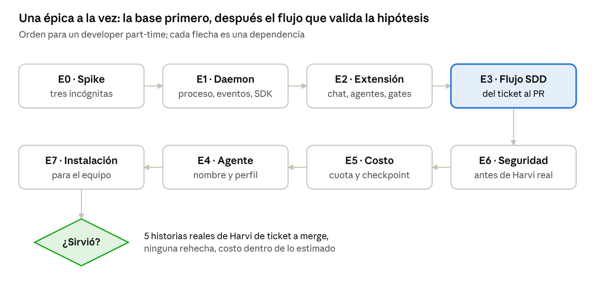

# MVP v0.1

**Para quién:** Andy y el equipo de Harvi, en proyectos reales (dogfooding). Windows,
VS Code, suscripción de Claude propia.

**Hipótesis:** un solo agente que lleva un ticket de GitHub hasta el PR con Spec Kit,
gates y modelo justo por tarea entrega historias que no hay que rehacer, a un costo
predecible, con el developer interviniendo solo para aprobar.

**Entra:** daemon local + extensión de VS Code · solo Claude (el puerto `AgentRuntime`
queda listo para Codex) · un equipo por vez · flujo SDD completo · gates con piso ·
agente principal con nombre y perfil · consumo, modelo por tarea y checkpoint · memoria
por proyecto y barandas de seguridad.

**No entra:** Codex y varias suscripciones (F2) · equipos en paralelo (F3) · celular (F4)
· equipo humano y biblioteca compartida (F5) · producto para terceros (E12).

## Cómo sabemos que funcionó

| Métrica | Objetivo |
|---|---|
| Historias reales de Harvi de ticket a merge con el flujo | 5, de al menos 2 proyectos |
| Historias rehechas después del merge | 0 |
| Costo real contra estimado al gate de plan | ±50 % en 4 de 5 |
| Intervenciones fuera de los gates | la mitad o menos que con una sesión suelta |
| Cortes de cuota sin checkpoint | 0 |
| Lo vuelven a usar sin que nadie se los pida | sí |

## Spike de la fase 0

| Incógnita | Experimento | Cuenta como sí | Si la respuesta es no |
| --- | --- | --- | --- |
| **¿Se puede distribuir con la suscripción de Claude de cada usuario?** | Leer los términos vigentes de Anthropic y consultar a soporte con el caso concreto | Respuesta escrita que lo permita, o términos que lo dejen claro | El MVP sigue igual (uso propio); para terceros, API keys como camino principal |
| **¿Cuántas sesiones concurrentes admite una suscripción?** | Lanzar 1, 2 y 3 sesiones del Agent SDK en paralelo con la misma cuenta | Dos sesiones sin errores y consumo legible por sesión | El paralelismo de la fase 3 requiere dos suscripciones o API keys |
| **¿Funciona daemon + extensión de punta a punta en Windows?** | Prueba mínima: named pipe con token, sesión del Agent SDK, tarea en un worktree, salida en vivo y diff nativo | La tarea corre, la salida se ve en vivo y el diff abre en VS Code | Se revisa ADR-025 antes de seguir |

Timebox: dos semanas part-time. Entregable: un informe por incógnita en `docs/spike/`.

## Épicas

E0 Spike · E1 Daemon núcleo · E2 Extensión de VS Code · E3 Flujo proporcional de punta a punta ·
E4 Agente principal · E5 Costo bajo control · E6 Barandas de seguridad · E7 Instalación
en el equipo de Harvi. Después del MVP: E8 Codex y varias suscripciones · E9 Equipos en
paralelo · E10 Celular · E11 Equipo humano · E12 Producto para terceros.

El detalle de cada una vive en [su issue](https://github.com/amiretti/SpecMate/issues?q=label%3Aépica).

Una épica en curso a la vez: el paralelismo lo ponen los agentes dentro de cada
historia. E3 se construye con el propio producto; E6 va antes de usarlo en proyectos
reales de Harvi.
