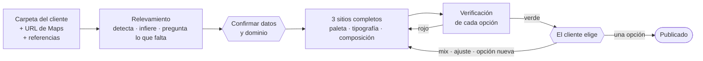

# MVP v0.2 — Sitios para negocios

> Reemplaza al MVP v0.1 (workspace general) desde [ADR-0029](adr/ADR-0029-pivot-sitios-para-negocios.md).

**Para quién:** Harvi, para vender y entregar sitios a negocios que necesitan presencia
en línea: comercios, profesionales, clubes, mutuales, gastronomía. Lo usa Andy en
Windows, con su suscripción de Claude.

**Hipótesis:** dada una carpeta con el material del cliente, la URL de Google Maps y
algunas referencias, SpecMate entrega **tres sitios completos y verificados** para
elegir, con datos confirmados y diseño propio, y la única intervención humana es
confirmar los datos al principio y elegir al final. Hoy un sitio lleva unas **24 horas
de desarrollo y una o dos semanas** de idas y vueltas.

**Entra:**
- one page, landing o sitio de pocas páginas, estático (Astro);
- contacto por enlaces (teléfono, mail, WhatsApp);
- botón "Cómo llegar" a Google Maps;
- SEO local;
- publicación en Cloudflare;
- relevamiento guiado que pregunta solo lo que falta (ADR-0031);
- dos intervenciones humanas: datos al principio y elección al final;
- tres opciones completas y combinables: mix, ajustes y opciones nuevas (ADR-0032);
- biblioteca de secciones con variantes verificadas;
- verificación automática que bloquea la publicación.

**No entra:** formulario con backend (E7) · mantenimiento y re-auditoría (E8) · edición
por el cliente o CMS (E9) · tienda, reservas o pagos · producto para otras agencias (E10).

## El flujo

El relevamiento lo corre Harvi en VS Code sobre la carpeta del cliente: primero busca en
la carpeta (manual de marca, logo, fotos, textos), después infiere (rubro, objetivo,
tono) y solo pregunta lo que falta ([ADR-0031](adr/ADR-0031-relevamiento-guiado.md)).
Con los datos confirmados, el sistema arma tres sitios completos que difieren en
paleta, tipografía y composición, los verifica y los publica en URLs de prueba. El
cliente elige uno, o pide un mix, un ajuste o una opción nueva, y cada pedido genera
una versión nueva ([ADR-0032](adr/ADR-0032-opciones-combinables.md)).

## Cómo sabemos que funcionó

| Métrica | Objetivo |
|---|---|
| Sitios reales publicados con el flujo | 3, de clientes distintos |
| Horas de trabajo de Harvi por sitio | ≤ 3 h (hoy unas 24 h) |
| Tiempo de calendario, de la carpeta a la publicación | ≤ 3 días hábiles (hoy 1 a 2 semanas o más) |
| Intervenciones humanas | 2: datos al principio y elección al final |
| Tiempo de máquina hasta las tres opciones verificadas | ≤ 1 h; el costo en tokens se mide en el spike |
| Datos publicados sin fuente ni confirmación | 0 |
| Controles de ADR-0030 en rojo al publicar | 0 (lo impone `verify`) |
| Lighthouse móvil | Rendimiento ≥ 90; accesibilidad, buenas prácticas y SEO ≥ 95 |
| Clientes que eligen una opción o un mix sin pedir una opción nueva | 2 de 3 |
| Rondas de pedidos (mix, ajuste u opción nueva) antes de publicar | 1 o menos por sitio |

## Spike de la fase 0

| Incógnita | Experimento | Cuenta como sí | Si la respuesta es no |
|---|---|---|---|
| **¿Sale un sitio publicable con el flujo hecho a mano, y en cuántas horas?** | Un cliente real de Harvi de punta a punta con Claude Code, las skills de diseño y una plantilla mínima, midiendo horas por etapa | Sitio publicado que el cliente acepta, con horas registradas por etapa | Se revisa qué etapa no rinde antes de automatizar |
| **¿La API de Places sirve para pre-llenar, dentro de sus términos y a costo razonable?** | Pedir los detalles de 3 negocios reales; anotar campos útiles, costo por pedido y lo que exigen los términos | Nombre, dirección, horarios, teléfono y ubicación por menos de USD 0,05 por sitio, sin guardar su contenido | El brief se llena solo con la carpeta y la confirmación del cliente |
| **¿Tres opciones completas y combinables son vendibles?** | Para el cliente del spike: tres sitios completos con una biblioteca mínima de secciones; después, un mix y un ajuste | El cliente elige una opción o un mix; el mix sale sin modelo y en minutos | La elección vuelve a tener pasos intermedios con el cliente (ADR-0031) |
| **¿Astro con CSP estricta pasa los controles de ADR-0030?** | Plantilla mínima con `_headers`, sin inline, medida con Lighthouse y axe | Todos los umbrales de ADR-0030 en verde | Se revisa ADR-0030 antes de E1 |

Timebox: dos semanas part-time. Entregable: `docs/spike/informe.md` con una sección
por incógnita, las horas medidas y los cambios que piden a las ADR.

## Épicas

**MVP:** E0 Spike · E1 Plantilla segura del sitio · E2 Relevamiento guiado y brief verificable ·
E3 Opciones combinables y elección · E4 Biblioteca de secciones y construcción ·
E5 Verificación y publicación · E6 Tres clientes reales.

**Después del MVP:** E7 Formulario de contacto con backend · E8 Mantenimiento y
re-auditoría · E9 Edición por el cliente · E10 Producto para otras agencias · E11 Relevamiento completado por el cliente.

El detalle de cada una vive en [su issue](https://github.com/amiretti/SpecMate/issues?q=label%3Aépica+is%3Aopen).

Una épica en curso a la vez, en este orden: E1 → E2 → E4 → E3 → E5 → E6. E1 va primero
porque fija lo que `verify` controla; E4 va antes que E3 porque las opciones se arman
con la biblioteca de secciones; E6 usa el producto en clientes reales y mide.
