# MVP v0.2 — Sitios para negocios

> Reemplaza al MVP v0.1 (workspace general) desde [ADR-0029](adr/ADR-0029-pivot-sitios-para-negocios.md).

**Para quién:** Harvi, para vender y entregar sitios a negocios que necesitan presencia
en línea: comercios, profesionales, clubes, mutuales, gastronomía. Lo usa Andy en
Windows, con su suscripción de Claude.

**Hipótesis:** dada una carpeta con el material del cliente, la URL de Google Maps y
algunas referencias, SpecMate entrega un sitio estático publicable, con datos
confirmados, controles de seguridad y calidad en verde y un diseño que el cliente
acepta, en **la mitad de las horas** que lleva hoy hacerlo a mano.

**Entra:**
- one page, landing o sitio de pocas páginas, estático (Astro);
- contacto por enlaces (teléfono, mail, WhatsApp);
- botón "Cómo llegar" a Google Maps;
- SEO local;
- publicación en Cloudflare;
- relevamiento guiado y cuatro gates humanos: datos, marca, bosquejo y vista previa;
- verificación automática que bloquea la publicación.

**No entra:** formulario con backend (E7) · mantenimiento y re-auditoría (E8) · edición
por el cliente o CMS (E9) · tienda, reservas o pagos · producto para otras agencias (E10).

## El flujo

```mermaid
flowchart LR
    In["Carpeta del cliente<br/>+ URL de Maps<br/>+ referencias"] --> Rel["Relevamiento<br/>detecta · infiere · pregunta lo que falta"]
    Rel --> G1{{"Gate datos"}}
    G1 --> Marca["3 paletas → 3 tipografías"]
    Marca --> G2{{"Gate marca"}}
    G2 --> Bosq["3 bosquejos"]
    Bosq --> G3{{"Gate bosquejo"}}
    G3 --> Build["Sitio estático<br/>tests primero"]
    Build --> Verify["Verificación<br/>seguridad · a11y · rendimiento · SEO"]
    Verify -->|rojo| Build
    Verify -->|verde| G4{{"Gate vista previa"}}
    G4 --> Pub([Publicado])
```

El relevamiento lo corre Harvi en VS Code sobre la carpeta del cliente: primero busca en
la carpeta (manual de marca, logo, fotos, textos), después infiere (rubro, objetivo,
tono) y solo pregunta lo que falta. Al cliente le llegan los links para elegir. Los
pasos están en [ADR-0031](adr/ADR-0031-relevamiento-guiado.md).

## Cómo sabemos que funcionó

| Métrica | Objetivo |
|---|---|
| Sitios reales publicados con el flujo | 3, de clientes distintos |
| Horas por sitio, de la carpeta a la publicación | ≤ 50 % de las de hoy ([HORAS ACTUALES POR SITIO], a medir en el spike) |
| Datos publicados sin fuente ni confirmación | 0 |
| Controles de ADR-0030 en rojo al publicar | 0 (lo impone `verify`) |
| Lighthouse móvil | Rendimiento ≥ 90; accesibilidad, buenas prácticas y SEO ≥ 95 |
| Clientes que eligen paleta, tipografía y bosquejo sin pedir rediseño | 2 de 3 |
| Rondas de cambios del cliente después del Gate 3 | 1 o menos por sitio |

## Spike de la fase 0

| Incógnita | Experimento | Cuenta como sí | Si la respuesta es no |
|---|---|---|---|
| **¿Sale un sitio publicable con el flujo hecho a mano, y en cuántas horas?** | Un cliente real de Harvi de punta a punta con Claude Code, las skills de diseño y una plantilla mínima, midiendo horas por etapa | Sitio publicado que el cliente acepta, con horas registradas por etapa | Se revisa qué etapa no rinde antes de automatizar |
| **¿La API de Places sirve para pre-llenar, dentro de sus términos y a costo razonable?** | Pedir los detalles de 3 negocios reales; anotar campos útiles, costo por pedido y lo que exigen los términos | Nombre, dirección, horarios, teléfono y ubicación por menos de USD 0,05 por sitio, sin guardar su contenido | El brief se llena solo con la carpeta y la confirmación del cliente |
| **¿Las propuestas de marca y los bosquejos son vendibles?** | Para el cliente del spike: tres paletas desde su logo, tres tipografías y tres bosquejos | El cliente elige en cada paso sin pedir rediseño | Los gates de marca y bosquejo pasan a ser trabajo de diseño humano con apoyo de IA |
| **¿Astro con CSP estricta pasa los controles de ADR-0030?** | Plantilla mínima con `_headers`, sin inline, medida con Lighthouse y axe | Todos los umbrales de ADR-0030 en verde | Se revisa ADR-0030 antes de E1 |

Timebox: dos semanas part-time. Entregable: `docs/spike/informe.md` con una sección
por incógnita, las horas medidas y los cambios que piden a las ADR.

## Épicas

**MVP:** E0 Spike · E1 Plantilla segura del sitio · E2 Relevamiento guiado y brief verificable ·
E3 Marca y bosquejos · E4 Construcción del sitio ·
E5 Verificación y publicación · E6 Tres clientes reales.

**Después del MVP:** E7 Formulario de contacto con backend · E8 Mantenimiento y
re-auditoría · E9 Edición por el cliente · E10 Producto para otras agencias · E11 Relevamiento completado por el cliente.

El detalle de cada una vive en [su issue](https://github.com/amiretti/SpecMate/issues?q=label%3Aépica+is%3Aopen).

Una épica en curso a la vez. E1 va antes que todo lo demás porque fija lo que
`verify` controla; E6 usa el producto en clientes reales y mide.
